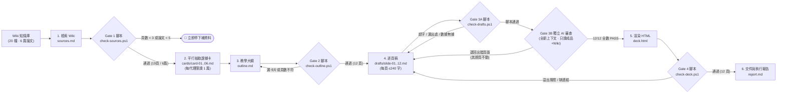

# Node 6 產出：Graph Workflow 執行紀錄與設計反思報告（`report.md`）

> 主題：**Agent Memory（AI 代理的記憶機制）：如何治好聊天機器人的「金魚腦」？**  
> 對應規範：[AGENTS.md](../AGENTS.md) ｜ [topic-slides.md](../.agents/workflows/topic-slides.md)

---

## 一、Graph Workflow 流程設計圖

本專案將「從 LLM Wiki 製作教學 HTML 簡報」拆成 **6 個檔案落盤節點、4 道可執行 PowerShell 檢查關卡，以及 1 道獨立 AI 忠實度審查關卡**。任何一關未過都沿指定邊精準退回，而不必整份重做。

### 節點輸入、輸出與權限隔離表

| 節點 / 關卡 | 只能讀取的輸入 | 產出或檢查結果 | 退回路線與剎車 |
| :--- | :--- | :--- | :--- |
| **Wiki Lint（前置）** | `wiki/**/*.md`、`raw/*.md` | `scripts/lint-wiki.ps1` | 發現斷鏈、孤島頁或缺 `⚠️ 觀點差異` 立即修正 |
| **1. 檢索 (`sources.md`)** | `wiki/index.md` | `topic-agent-memory/sources.md` | `Gate 1` 不足 3 頁或少於 5 篇論文則**停止** |
| **2. 平行證據卡 (`cards/`)** | **僅限單一指定論文頁＋實體頁** | `card-01`..`card-06.md`（6 個平行子代理） | 嚴禁跨篇混讀；卡片漏誤僅重抽該篇 |
| **3. 大綱 (`outline.md`)** | `sources.md`、`cards/*.md` | `topic-agent-memory/outline.md` | `Gate 2` 確認涵蓋全部 6 篇卡片與 8–15 頁區間 |
| **4. 逐頁稿 (`drafts/`)** | `outline.md`、對應 `card-XX.md` | `slide-01`..`slide-12.md` | `Gate 3A` 卡控 `≤240` 字與數字來源；`Gate 3B` 由獨立審查員核對 |
| **5. 渲染 (`deck.html`)** | 已通過 Gate 3 的 `drafts/*.md` | `deck.html` | 嚴禁排版時改動事實數字；`Gate 4` 不過則退回 `Node 4` 縮字 |

---

## 二、一次完整實際執行的檢查紀錄

### 階段 A：LLM Wiki 建立與 Lint 健康檢查紀錄
1. **Batch 1 Ingest（前 2 篇試寫）**：完成 `Generative Agents (2023)` 與 `CoALA (2024)` 共 8 個 Wiki 檔後執行 `scripts/lint-wiki.ps1`，輸出：`Checked 8 wiki files (6 content pages). PASS: 0 broken links, 0 orphans, all citation & naming rules satisfied.`，隨即執行 `git commit`（`12d8f52`）。
2. **Batch 2 Ingest（補齊其餘 4 篇＋綜合頁）**：補齊 `ACM TOIS Survey`、`HippoRAG`、`A-MEM`、`Mem0` 與 2 篇跨篇綜合比較後執行 `scripts/lint-wiki.ps1 -RequireSynthesis`，輸出：`Conflict markers verified in 6 wiki file(s). Checked 20 wiki files (18 content pages). PASS: 0 broken links, 0 orphans, all citation & naming rules satisfied.`，提交 `git commit`（`d916f97`）。

### 階段 B：Graph Workflow 實跑紀錄（含真實退回與跨輪修正）

| 執行輪次 | 關卡 / 節點 | 實際檢查輸出 | 發現的問題與退回處置 |
| :--- | :--- | :--- | :--- |
| **Run 1** | `Gate 1: check-sources.ps1` | **PASS**（`19` 個 Wiki 頁、涵蓋 `6` 篇論文） | 無問題，進入平行證據卡抽取 |
| **Run 1** | `Node 2: 6 平行子代理` | **DONE**（6 張卡片獨立完成） | 嚴格隔離每代理只看 1 篇，零跨篇數字混用 |
| **Run 1** | `Gate 2: check-outline.ps1` | **PASS**（`12` 頁、涵蓋全部 `card-01..06`） | 無問題，進入逐頁稿撰寫 |
| **Round 1** | `Gate 3A: check-drafts.ps1` | **PASS**（12 頁皆 `≤240` 字且數字皆可回溯至 `cards/`） | 腳本檢查過關，交由獨立 AI 審查員檢查語意忠實度 |
| **Round 1** | `Gate 3B: 獨立 AI 審查員` | **NEEDS_REVISION**（6 頁需修：`Slide 01, 06, 07, 08, 09, 11`；5 頁微調；`Slide 05` 直接過關） | 抓出具體瑕疵： • `Slide 01` 混用 CoALA 跨對話與 Mem0 長對話情境，且加入原文沒有的「週五炸雞排」 • `Slide 06` 把「20 個百分點」寫成「20%」、漏寫 `All-Recall@5` 指標名 • `Slide 07` 消融誤標 `Sec. 4.3`（應為 `Sec. 4.4`） • `Slide 08` 未定義 `J` 分數且漏寫 `Full-Context` 準確率 `72.90%` • `Slide 09` 漏列 `memory-taxonomy.md`、把 `Mem0^g` 總延遲與檢索延遲混成 `2–3 倍` • `Slide 11` 誤引 `[綜合比較 Sec. 1]`。 👉 **處置**：保留 `Slide 05`，精準退回 `Node 4` 修改上述頁面 |
| **Round 2** | `Gate 3A: check-drafts.ps1` | **FAIL**（1 個錯誤：`slide-08.md: 254 chars > budget 240 chars`） | 補齊 `Full-Context` 與 `J` 的前提說明後，`slide-08.md` 字數超出單頁上限！ |
| **Round 2** | `Gate 3B: 獨立 AI 審查員` | **NEEDS_REVISION**（11/12 頁 **PASS**，僅 `Slide 08` 需再修） | `Slide 08` 在編輯時意外刪掉 `Neo4j 標記衝突舊關係失效` 機制，且 `J=72.90%` 出現在定義前一行。 |
| **Round 3** | `Gate 3A` (初修 `slide-08`) | **FAIL**（`slide-08.md: 256 chars > budget 240 chars`） | 恢復 `Neo4j` 機制並保持完整英文專有名詞後仍超字 16 字，退回 `Node 4` 進行精煉縮寫（壓至 `228` 字）。 |
| **Round 3** | `Gate 3A + Gate 3B` (終版) | **PASS**（`check-drafts.ps1` exit 0；獨立審查員確認 `Slide 08` 與全體 12 頁 **PASS**） | 忠實度、出處章節與單頁字數密度全數達標，放行進入 `Node 5` 渲染！ |
| **Final** | `Gate 4: check-deck.ps1` | **PASS**（`12` 頁、`57 KB`、0 佔位符、全部 `data-wiki-source` 與連結有效、無溢出風險） | 順利交件產出 `deck.html` |

---

## 三、深度反思（Reflection）

### 1. 哪一個節點最常出錯？
**`Node 4（逐頁稿 drafts/）` 是整個流程中最常出錯、反覆修正次數最多的節點。**  
原因在於它同時承受兩股相反的壓力：一方面必須把複雜論文濃縮成初學者讀得懂的精簡口語，一不留神就會像 Round 1 的 `Slide 01`、`Slide 06`、`Slide 07` 那樣**腦補生活例子、混用「%」與「百分點」、或標錯小節號**；另一方面，當 Round 2 依據獨立審查員建議把基準名稱、指標定義與適用條件補全後，又立刻引發字數膨脹，連續兩次被 `check-drafts.ps1` 攔下超標（`254` 字、`256` 字 > `240` 字上限）。

### 2. 發現問題後，你把檢查往前移到了哪一個步驟？
原本最容易發生的痛點，是等到 **`Node 5（HTML 渲染）` 做完才發現「這頁字太多破版」或「某個數字沒講清楚前提」**，屆時就要從網頁渲染一路轉大圈退回重寫文案與版面。  
在本專案設計中，我們把這兩項檢查**前移到 `Gate 3（逐頁稿關卡）`**：
- **排版防呆前移**：在 `check-drafts.ps1` 就先用「每頁 ≤ 240 字、≤ 5 點」卡關，成功在渲染 HTML 前就把 `slide-08.md` 的超字風險攔下來。
- **獨立 AI 忠實度審查前移**：不等到 `deck.html` 成型，在純文字的 `drafts/` 階段就派全新上下文子代理逐頁核對 `wiki/`，把 6 頁的章節編號與基準前提問題一次抓齊，讓後面的 `Gate 4 (check-deck.ps1)` 一次通過、幾乎不需要轉大圈。

### 3. 你有沒有因此修改 Workflow / Graph？為什麼？
**有。** 在經歷 Round 1 到 Round 3 的實際卡關後，我發現只靠外部腳本與事後審查仍不夠快——如果撰稿當下就能避開常見失誤，小圈就能更早收斂。因此我回頭修改了 `.agents/workflows/topic-slides.md`，在規範的「實作後增補清單」明確加入三條前移規則：
1. **首次名詞必釋義**：專業指標（例如 `LLM-as-a-Judge 評分 J`）首次出現前必先給 10 字內白話定義，避免出現「數字先出現、解釋在下一行」的狀況。
2. **數據必綁基準與單位**：所有實驗數據必須同時寫明資料集與正確單位（區分相對 `%` 與「百分點」）。
3. **標頭與內文出處即時對齊**：逐頁稿產出後先比對內文引用的 `Sec. X` 是否皆已列在 `出處：` 欄位，再送交 Gate 3。
